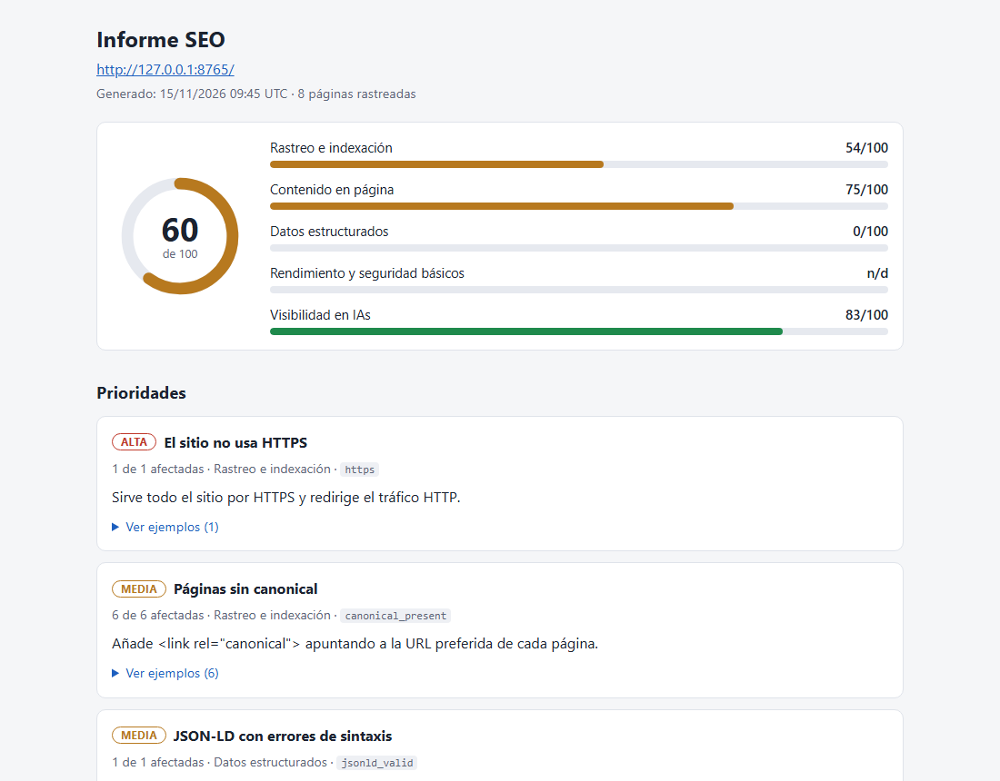

# seo-auditor

[](https://github.com/Guille6520/seo-auditor/actions/workflows/ci.yml)  

Auditor SEO técnico, sencillo y **reproducible**. Rastrea un sitio, aplica 27 comprobaciones escritas en código y calcula una nota de 0 a 100 que sale siempre igual con las mismas observaciones. Sin modelos de lenguaje, sin claves de API y sin servicios externos.


*El vídeo completo está en [docs/demo.mp4](docs/demo.mp4). Todo lo que se ve es salida real del programa sobre el sitio de ejemplo de [demo/](demo/sitio.py).*

```
seo-auditor audit https://tuweb.com
  ->  reports/informe.html   informe visual, autocontenido
      reports/informe.md     resumen para leer o pegar
      reports/informe.json   todos los datos, para comparar o automatizar
```

El informe HTML es un único fichero que se abre en cualquier navegador:



## Por qué existe

Un auditor pensado para ser fiable antes que amplio:

| | seo-auditor |
|---|---|
| **Nota** | Calculada por código: mismas observaciones, misma nota ([fórmula](docs/NOTA.md)) |
| **Evidencia** | Cada hallazgo lleva la URL y el detalle que lo prueba |
| **Rastreo** | Propio, en anchura, respetando `robots.txt`, con límites de páginas y profundidad |
| **Honestidad** | Lo que no se pudo medir aparece como *no evaluado* y no puntúa |
| **Coste** | Cero: corre en tu máquina, sin API ni cuotas |
| **Alcance** | Deliberadamente estrecho: una orden para auditar y otra para comparar |

## Instalación

Requiere Python 3.11 o superior.

```bash
git clone https://github.com/Guille6520/seo-auditor.git
cd seo-auditor
python -m venv .venv
.venv\Scripts\activate        # en Linux/macOS: source .venv/bin/activate
pip install -e ".[dev]"
```

## Uso

### Auditar

```bash
seo-auditor audit https://tuweb.com --max-pages 50 --out reports
```

| Opción | Por defecto | Qué hace |
|---|---|---|
| `--max-pages` | 50 | Páginas máximas a rastrear |
| `--max-depth` | 3 | Clics de distancia máxima desde la portada |
| `--delay` | 0.2 | Segundos de pausa entre peticiones |
| `--out` | `reports` | Carpeta de salida |
| `--fail-under N` | 0 | Sale con código 2 si la nota es menor que N |
| `--allow-private` | no | Permite IPs locales o privadas (solo para pruebas) |

Códigos de salida: `0` correcto, `1` error (sitio inaccesible o URL bloqueada), `2` nota por debajo de `--fail-under`.

### Comparar dos auditorías

```bash
seo-auditor compare reports-antes/informe.json reports/informe.json
```

Muestra la nota antes y después, la diferencia por categoría y qué comprobaciones se han resuelto, cuáles son nuevas y cuáles mejoran o empeoran, con las URLs corregidas. Avisa si los dos informes no son del todo comparables (distinto número de páginas, rastreo incompleto, otra versión de la fórmula). Con `--json` devuelve los mismos datos en JSON.

## Demostración reproducible

El repositorio incluye un sitio de ejemplo (una panadería ficticia) en dos versiones: `antes`, con fallos puestos a propósito, y `despues`, con los fallos corregidos.

```bash
python demo/sitio.py antes          # en una terminal
seo-auditor audit http://127.0.0.1:8765 --allow-private --out informes/antes

python demo/sitio.py despues        # tras parar el anterior con Ctrl+C
seo-auditor audit http://127.0.0.1:8765 --allow-private --out informes/despues

seo-auditor compare informes/antes/informe.json informes/despues/informe.json
```

Resultado: **60/100 → 93/100**. Los informes generados están guardados como ejemplo:

(GitHub muestra los `.html` como código; para verlos como en la captura, descárgalos y ábrelos en el navegador.)

- Antes: [HTML](docs/ejemplo/informe-antes.html) · [Markdown](docs/ejemplo/informe-antes.md) · [JSON](docs/ejemplo/informe-antes.json)
- Después: [HTML](docs/ejemplo/informe-despues.html) · [Markdown](docs/ejemplo/informe-despues.md) · [JSON](docs/ejemplo/informe-despues.json)
- [Comparación](docs/ejemplo/comparacion.md)

La versión corregida no llega a 100 porque el sitio de ejemplo se sirve por HTTP en local y la comprobación de HTTPS falla, como debe.

## Qué comprueba

27 comprobaciones en cinco categorías. La lista completa, con pesos y umbrales, está en [docs/NOTA.md](docs/NOTA.md).

| Categoría | Ejemplos |
|---|---|
| Rastreo e indexación | Páginas con error, enlaces internos rotos, cadenas de redirección, `noindex`, canonical, HTTPS, `robots.txt`, sitemap, páginas huérfanas |
| Contenido en página | Título y meta description (presencia, longitud, duplicados), H1 único, contenido escaso, `alt` en imágenes, `lang`, viewport |
| Datos estructurados | JSON-LD con sintaxis válida, JSON-LD en la portada |
| Rendimiento y seguridad básicos | HSTS; tiempo de respuesta (informativo) |
| Visibilidad en IAs | Rastreadores de IA bloqueados en `robots.txt`; `llms.txt` (informativo) |

## Límites

Conviene saberlos antes de fiarse de la nota:

- **No renderiza JavaScript.** Analiza el HTML que sirve el servidor; un sitio que pinta su contenido en el navegador saldrá con poco texto y pocos enlaces.
- **No mide Core Web Vitals** ni rendimiento real de usuario. El tiempo de respuesta es informativo y no puntúa.
- **No valida schema.org**, solo que el JSON-LD sea JSON válido.
- **No analiza** backlinks, palabras clave ni posiciones.
- **Los pesos y umbrales son criterio propio**, no un estándar. La nota resume la higiene técnica básica; no predice posiciones.
- Su precisión no se ha contrastado de forma sistemática con otras herramientas. Se ha probado contra tres sitios reales (python.org, gnu.org y Wikipedia en español), comprobando a mano una muestra de los hallazgos contra el HTML servido.

## Seguridad

- **SSRF:** no se conecta a direcciones privadas, locales ni de metadatos de nube, y valida cada salto de redirección. Límite conocido: no fija la IP resuelta, así que no protege frente a *DNS rebinding*; habría que resolverlo antes de ofrecerlo como servicio público.
- **XML:** los sitemaps se leen sin entidades externas ni acceso a red.
- **Informe HTML:** todo dato procedente del sitio auditado se escapa, y el documento lleva una política de seguridad de contenido que impide ejecutar scripts.

Más detalle en [docs/ARQUITECTURA.md](docs/ARQUITECTURA.md).

## GitHub Actions (opcional, solo manual)

El uso previsto es local. El workflow [audit.yml](.github/workflows/audit.yml) permite lanzar una auditoría desde GitHub, pero **no tiene programación automática**: solo consume minutos cuando se lanza a mano desde *Actions → Auditoría SEO → Run workflow*. El informe queda en el resumen del trabajo y como artefacto. Para programarlo basta con añadir un bloque `schedule` en `on:`.

## Desarrollo

```bash
pip install -e ".[dev]"
ruff check .
pytest -q
```

Los tests no usan Internet: levantan un servidor HTTP local con un sitio de prueba que tiene fallos conocidos y comprueban que cada uno se detecta y que lo correcto no se marca.

Para regenerar el vídeo y los informes de ejemplo: `python demo/grabar_video.py` (necesita `playwright` e `imageio-ffmpeg`, que no son dependencias del auditor).

## Documentación

- [docs/ARQUITECTURA.md](docs/ARQUITECTURA.md): módulos, flujo de datos y seguridad.
- [docs/NOTA.md](docs/NOTA.md): fórmula de la nota y detalle de cada comprobación.
- [docs/DECISIONES.md](docs/DECISIONES.md): decisiones, límites conocidos y plan.

## Licencia

MIT. Ver [LICENSE](LICENSE).
